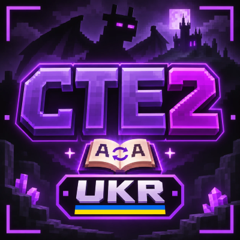

<p align="center"></p>

# CTE2-UK — український переклад Craft to Exile 2

Клієнтський Forge-мод, який перекладає збірку **Craft to Exile 2** українською:
предмети, квести, меню, підказки Mine and Slash і рядки, які моди пишуть англійською прямо в коді.

| | |
|---|---|
| Збірка | Craft to Exile 2 — 2.1.4 |
| Minecraft / Forge | 1.20.1 / 47.4.23 |
| Сторона | лише клієнт (на сервер ставити не потрібно) |

## Встановлення

1. Завантажте `CTE2-UK-<версія>.jar` з розділу **Releases**
   (або останню збірку з вкладки **Actions → build → Artifacts**).
2. Покладіть jar у теку `mods` вашої збірки CTE2.
   Якщо там є старий `CTE2-UK-Mod-*.jar`, видаліть його: обидва моди мають однаковий id.
3. Запустіть гру.

Під час першого запуску мод сам:
- покладе мовний пакет і перекладені конфіги меню в теку гри;
- перемкне мову на українську (один раз — далі можна вибирати будь-яку).

Файли, які ви змінювали самі, мод не чіпає: замінюються лише оригінальні файли збірки або попередні версії перекладу.
Автоматичний вибір мови вимикається в `config/cte2_uk-client.toml` (`selectUkrainianOnStartup = false`).

## Як це працює

Переклад складається з трьох шарів:

1. **Мовний пакет** `cte2_uk_lang.zip` — ~250 файлів `uk_ua.json` для модів збірки.
   Мод кладе його в `config/openloader/resources/`, а [OpenLoader](https://www.curseforge.com/minecraft/mc-mods/open-loader) підключає як ресурспак.
   Це понад 95% перекладу.
2. **Інші файли збірки** — написи FancyMenu, конфіги Chat Plus, Keyflow, магазину професій
   і KubeJS-скрипт. Їх теж встановлює мод.
3. **Код мода**:
   - встановлювач файлів із перевіркою SHA-256 (див. `manifest.tsv`);
   - заміна англійських рядків, які моди виводять без lang-ключів
     (ключі `cte2_uk.literal.<мод>.<англійський текст>` у `assets/cte2_uk/lang/uk_ua.json`);
   - міксини для Mine and Slash, Mine and Meals та Exile Overlay;
   - виправлення інтерфейсу під довші українські тексти (у роботі).

Кожне виправлення працює лише з мовою `uk_ua` і тихо вимикається, якщо цільовий мод змінився, тож гра не падає.

## Розробка

Потрібен **JDK 17**. Перший запуск Gradle завантажує Minecraft і Forge (кілька хвилин).

```bash
./gradlew build          # jar у build/libs/ + тести
./gradlew installToGame  # зібрати й покласти в mods збірки SKLauncher
./gradlew runClient      # чистий Forge-клієнт із модом (без модів збірки)
./gradlew installHashes  # SHA-256 файлів для manifest.tsv
```

`installToGame` шукає збірку в `%APPDATA%/.sklauncher/instances/<instance_name>`.
Інший шлях задайте в `~/.gradle/gradle.properties`: `sklauncher_dir=D:/Games/.sklauncher`.

### Структура

```
src/main/java/ua/cte2uk/
  Cte2Uk.java               точка входу
  Lang.java, Ukrainian.java доступ до перекладів, перевірка мови
  core/                     вибір мови, конфіг, встановлювач файлів
  tooltip/                  заміна англійських рядків у підказках
  text/                     дрібні перетворення тексту (лічильник днів)
  mixin/mns, mixin/other    міксини для Mine and Slash та інших модів
src/main/resources/
  assets/cte2_uk/lang/      власні рядки мода
  cte2_uk/install/          файли для теки гри + manifest.tsv
ROADMAP.md                  що зроблено і що ще треба зробити
```

### Як додати переклад рядка в підказці

Якщо в підказці предмета лишився англійський рядок без lang-ключа, додайте в
`src/main/resources/assets/cte2_uk/lang/uk_ua.json`:

```json
"cte2_uk.literal.<id мода>.<точний англійський текст>": "Український текст"
```

Замість id мода можна написати `*` — тоді рядок замінюватиметься в будь-якого мода.
Кольорові коди (`§7`) і пробіли на краях зберігаються автоматично.

### Як оновити файл, що встановлюється в гру

1. Замініть файл у `src/main/resources/cte2_uk/install/files/`.
2. `./gradlew installHashes` → новий хеш у третю колонку `manifest.tsv`.
3. Старий хеш допишіть окремим рядком у другу колонку — щоб у гравців стара версія теж оновилась.

Тест `bundledManifestMatchesBundledFiles` не дасть зібрати мод із застарілим хешем.

### Правила коду

- Офіційні назви Mojang. Виняток — міксини в класи інших модів: там методи Minecraft пишуться srg-назвами (`m_7856_`) з `remap = false`.
- Український текст — у lang-файлах, не в Java.
- Повідомлення в лог — англійською (лог гри не в UTF-8).
- Міксини в класи інших модів — з `@Pseudo` і `require = 0`.
- Тримайте міксини тонкими: логіку виносьте у звичайні класи (`text/`, `tooltip/`). У коді міксинів не викликайте методи масивів (`args.clone()`) — Mixin 0.8.5 на цьому падає; беріть `Arrays.copyOf`.

## Стан

Готово: встановлення файлів, вибір мови, рядки в підказках предметів, вікі й предмети Mine and Slash, Mine and Meals, лічильник днів.
У роботі: екран статів Mine and Slash, положення підказок, компактна розкладка вікі та книг Patchouli.
Подробиці — у [ROADMAP.md](ROADMAP.md).

## Учасники

- [@HolovaNazarii](https://github.com/HolovaNazarii) — переклад, автор проєкту

Хочете допомогти з перекладом чи кодом — відкривайте issue або pull request.

## Ліцензія

- **Код** — [MIT](LICENSE).
- **Переклад** (мовний пакет, рядки в lang-файлах, KubeJS-скрипт) — © CTE2-UK contributors, поширюється разом із модом.
- **Конфіги** FancyMenu, Chat Plus, Keyflow, магазину професій — змінені файли збірки Craft to Exile 2;
  права на оригінали належать їхнім авторам.

Проєкт неофіційний і не пов'язаний з Mojang, Microsoft чи авторами Craft to Exile 2 та модів, що в неї входять.
